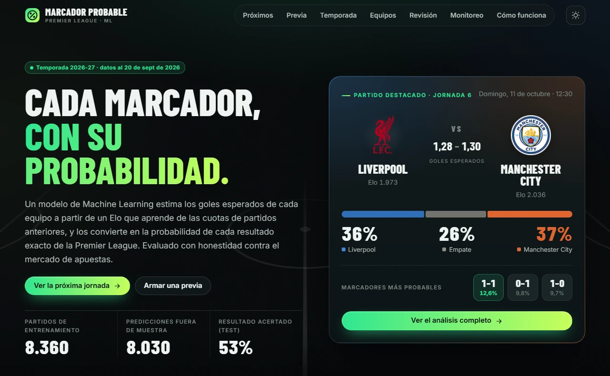
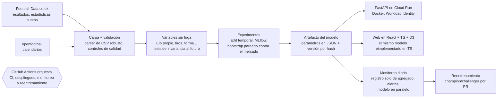
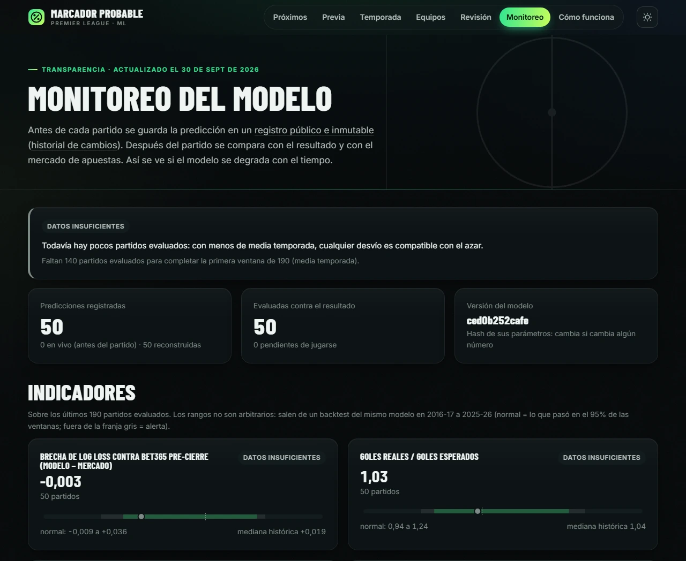

# Marcador Probable · predictor de partidos de cinco ligas de fútbol

**Un sistema de predicción de fútbol de punta a punta, evaluado con honestidad:** estima la probabilidad de cada
marcador exacto de un partido en cinco ligas (Premier League, LaLiga, Serie A, Bundesliga y Ligue 1; y de ahí local /
empate / visitante), la sirve a través de una API y de una web en vivo con selector de liga, registra cada predicción
antes del partido en un registro a prueba de manipulaciones y pone a prueba cada mejora con experimentos
preregistrados.

**[Web en vivo](https://ignaciogil23.github.io/futbol-predict/)** · **[Model card](docs/model_card.md)** ·
[English version](README.md)



## Resultados en 30 segundos

| Pregunta | Respuesta |
|---|---|
| **¿Le gana al mercado de apuestas?** | **No, pero se acercó mucho.** En las temporadas de test (2023-24 a 2025-26, 1.140 partidos) el log loss es **0,974** contra **0,966** de las cuotas pre-cierre de Bet365 y **0,944** del cierre de Pinnacle; la brecha con Bet365 es de +0,008 (IC 95% de 0,001 a 0,014), y era de +0,022 antes del rating basado en cuotas. Nunca usa las cuotas del partido que predice. |
| **¿Es competitivo con la literatura?** | **Sí.** En los mismos 3.300 partidos de Ley, Van de Wiele y Van Eetvelde (2019, *Statistical Modelling*), RPS **0,1942** contra **0,1953** del mejor de sus 10 modelos (diferencia dentro de nuestro IC; las diferencias de protocolo están documentadas). |
| **¿Qué lo mejora de verdad?** | **Información que el mercado ya había incorporado.** Un Elo que se actualiza con lo que el mercado esperaba antes de los partidos *anteriores* (Wunderlich y Memmert 2018) superó al Elo basado en resultados por −0,0084 de log loss en 19.763 partidos de cinco ligas (IC [−0,0100; −0,0067], 51 de 55 temporadas-liga) y pasó a producción el 01/10/2026 con una enmienda documentada; el modelo anterior se registra en paralelo para una comparación en vivo en julio de 2027. Los tiros también ayudan (−0,004 a −0,005, replicado en cuatro ligas) y se registran en paralelo. |
| **¿Qué no?** | Forma, tabla, descanso, enfrentamientos directos, Dixon-Coles, un Poisson bivariado, XGBoost (incluso entrenado con 5 ligas) y una corrección de la ventaja de local reciente: cada uno se probó y quedó documentado. Dos experimentos con datos de terceros (Fantasy Premier League, Transfermarkt) se retiraron por los términos de uso de esas fuentes. |
| **¿Qué le puede preguntar un hincha?** | **Cómo termina la temporada.** 10.000 simulaciones de los partidos que faltan (con el Elo actualizado dentro de cada una) dan las probabilidades de campeón, top 4 y descenso. Evaluado con 2015-26 contra un simulador que ignora la fuerza de los equipos: 45% menos de Brier para el top 4 antes de la fecha 1, y bien calibrado. Igual le dio 0% al Leicester en 2015-16. |
| **¿Dónde está la brecha con el mercado?** | No en los promedios sino en la información de cada partido: la mitad de la brecha sale del 14% de los partidos en los que modelo y mercado discrepan en 10 puntos o más, y en las fechas 1 a 5 se duplica (fichajes que los ratings todavía no absorbieron). |

## Arquitectura



## Cómo funciona el modelo

1. **Elo propio** actualizado partido a partido sobre la Premier League y la Championship, con un factor por diferencia
   de gol (Hvattum y Arntzen 2010), ajustado solo con temporadas de entrenamiento. El mismo modelo funciona en las
   cinco ligas.
2. **Dos regresiones de Poisson** (goles del local y del visitante) sobre la diferencia de Elo dan los goles esperados
   de cada equipo; su producto da la probabilidad de cada marcador, y sumando celdas sale local / empate / visitante.
3. **Elección por evidencia, no por complejidad:** frecuencias, un logit sobre el Elo, Dixon-Coles, el Poisson GLM y
   XGBoost fueron estadísticamente indistinguibles en validación, así que ganó el más simple.

## Decisiones de ingeniería que vale la pena mirar

* **La fuga se prueba, no se supone.** Toda variable del día *D* usa solo partidos anteriores a *D*. Los tests borran
  todos los resultados desde *D* y exigen que las variables de *D* no cambien. Detectaron una fuga real (el Elo inicial
  de un equipo recién ascendido dependía de resultados posteriores).
* **Una evaluación que no se puede hacer trampa.** Split temporal con un test que se usa una sola vez; log loss como
  métrica principal; el mercado (sin margen por el método de Shin) como referencia; intervalos de confianza por
  bootstrap pareado; una regla de promoción fija (≥ 0,005 de log loss y el IC por debajo de 0).
* **Preregistro.** Cada candidato nuevo tiene un protocolo commiteado en git *antes* que su código y sus resultados
  (`docs/preregistro_*.md`), así que el historial prueba el orden. Las otras cuatro ligas fueron el banco de pruebas
  del modelo (para no reutilizar una y otra vez los datos de la Premier) y ahora también son parte del producto.
* **Monitoreo a prueba de manipulaciones.** Las predicciones se agregan antes del partido a un registro en una rama
  aparte y nunca se reescriben; los umbrales de alerta salen de un backtest de 10 temporadas; el reentrenamiento llega
  como pull request con controles de sanidad.
* **Artefacto portable y auditable.** El modelo son parámetros en JSON (sin pickle) con una versión por hash; la web
  corre el mismo modelo en TypeScript, verificado contra vectores de prueba generados en Python.
* **Seguridad.** Cloud Run se despliega con Workload Identity Federation (sin claves de larga duración); la cuenta de
  servicio de ejecución no tiene permisos; la imagen de la API no incluye scipy ni pyarrow.



## Registro de experimentos

| Candidato | Dónde se probó | Log loss contra la base | Resultado |
|---|---|---|---|
| **Rating basado en cuotas (ELO-Odds, Wunderlich y Memmert 2018)** | **5 ligas 2015-26 (19.763 partidos)** | **−0,0084, IC [−0,0100; −0,0067]; reduce a la mitad la brecha con Bet365** | **En producción desde el 01/10/2026; el modelo anterior se registra en paralelo** |
| Tiros y tiros al arco | Premier League 2015-26; otras 4 ligas | −0,004 / −0,005; replicado: −0,0049 | En registro paralelo hasta julio de 2027 |
| Poisson bivariado (Karlis y Ntzoufras 2003) | Premier League 2015-23 | log loss de marcador exacto **peor** | Descartado (el exceso de empates no se mantuvo después de 2015) |
| Ventaja de local reciente | 4 ligas | −0,0001 | Corrige el sesgo de localía, sin mejora de log loss |
| GLM / XGBoost combinando 5 ligas | 4 ligas | +0,0001 / +0,0019 contra el modelo con tiros | Nada más allá de los tiros; XGBoost peor |
| xG y alineaciones de Fantasy; valor de mercado del plantel | — | — | Retirados: los términos de uso de las fuentes no permiten este uso ([model card](docs/model_card.md)) |

Tablas completas, intervalos de confianza y razonamiento: [model card](docs/model_card.md).

## Cinco ligas

El producto en vivo cubre la Premier League (Inglaterra), LaLiga (España), la Serie A (Italia), la Bundesliga
(Alemania) y la Ligue 1 (Francia). La web tiene un selector de liga y todas las secciones (partidos y previas, tabla y
proyección de la temporada, estadísticas, fichas de equipo, revisión fuera de muestra, monitoreo) funcionan por liga; la
API acepta `league` (`ENG`, `ESP`, `ITA`, `GER`, `FRA`; por defecto `ENG`).

* **El mismo modelo en todas:** Elo basado en cuotas (ELO-Odds) → dos regresiones de Poisson (goles del local y del
  visitante) → probabilidad de cada marcador exacto. Las regresiones de cada liga se entrenan con sus propios partidos
  (Premier desde 2004-05, España y Francia desde 2005-06, Italia y Alemania desde 2006-07). Datos: primera y segunda
  división de Football-Data.co.uk (SP1/SP2, I1/I2, D1/D2, F1/F2); calendarios de openfootball (espana, italy,
  deutschland, europe/france).
* **Los parámetros de rating propios de cada liga se probaron y se descartaron.** Con un preregistro
  ([`docs/preregistro_ligas.md`](docs/preregistro_ligas.md), reporte `reports/leagues/parametros_2026-10-27.json`),
  los dos ratings de cada liga se reajustaron con su primera división 2004-05..2014-15 y se compararon fuera de muestra
  (2015-16..2025-26) con los parámetros de Inglaterra. Regla: adoptarlos solo si la diferencia media de log loss es
  ≤ −0,002 y el IC 99,375% (Bonferroni, 8 comparaciones) queda entero por debajo de 0. Ninguna de las 8 comparaciones
  la cumplió (liga menos Inglaterra entre −0,0002 y +0,0011), así que todas usan los parámetros ajustados en Inglaterra.

| Liga | Log loss del modelo | Bet365 pre-cierre |
|---|---|---|
| LaLiga | 0,9640 | 0,9529 |
| Serie A | 0,9771 | 0,9668 |
| Bundesliga | 0,9769 | 0,9614 |
| Ligue 1 | 0,9891 | 0,9819 |

Temporadas de test 2023-24 a 2025-26 (las cifras de la Premier están en la tabla de arriba).

* **Simulación de la temporada por liga** (modelo con Elo de resultados), validada con el protocolo de la Premier
  (cortes proporcionales a la temporada: antes de la fecha 1 y tras el 26%, 53% y 79% de los partidos; plazas de
  descenso de cada liga; Francia 2019-20 omitida; reportes en `reports/season/<LIGA>_evaluacion_2026-10-27.json`).
  Habilidad contra el simulador con equipos iguales antes de la fecha 1, top 4: España 71%, Italia 50%, Alemania 49%,
  Francia 35%; campeón: España 27%, Italia 39%, Alemania 72%, Francia 50% (intervalos de 95% en los reportes). No
  modela el desempate por enfrentamiento directo (LaLiga, Serie A); en Bundesliga y Ligue 1 el 16.º juega una
  promoción y no se cuenta como descendido.
* **Monitoreo en vivo:** el registro de la Premier sigue igual; el flujo de monitoreo también guarda las predicciones
  previas de las demás ligas (`ledger/<LIGA>_predictions.csv` en la rama `monitoring`). Su evaluación en vivo todavía
  no está implementada: solo se evalúa el registro de la Premier.
* Los escudos (de las cinco ligas) y las fotos de estadio de las otras ligas salen de Wikimedia Commons (solo licencias
  libres, con créditos en cada ficha de equipo): hay foto para 71 de los 76 clubes actuales de las otras ligas y escudo
  para 32 de ellos; el resto muestra iniciales de 3 letras (la mayoría de los escudos españoles y franceses tienen
  derechos de autor y no están en Commons). Los clubes de la Premier muestran iniciales: ninguno de sus escudos actuales
  está en Commons con licencia libre, y los términos de premierleague.com no permiten reutilizarlos.

## Tecnologías

Python 3.11 · pandas · scikit-learn · XGBoost · MLflow · FastAPI · Docker · Google Cloud Run · GitHub Actions ·
React · TypeScript · Vite · D3 · pytest · Vitest · ruff · oxlint

## Reproducir

```bash
python -m venv venv && source venv/bin/activate        # Windows: venv\Scripts\activate
pip install -r requirements-dev.txt
python -m src.data.download && python -m src.data.load  # Football-Data (E0 + E1)
python -m src.data.leagues                              # las otras cuatro ligas (primera y segunda división)
python -m src.features.build
python -m src.serving.league_state                      # estado del rating por liga
python -m src.models.experiments --stage validation     # selección del modelo (MLflow: mlflow.db)
python -m src.serving.production                        # models/production/model.json
python -m src.serving.league_models --train             # modelos de Poisson por liga
python -m src.models.league_params                      # control de los parámetros de rating por liga
python -m src.models.season_eval --league ESP           # evaluación de la simulación de la temporada (por liga)
python -m src.export.site --out web/public/data         # JSON para la web
pytest && ruff check .                                  # tests y lint (igual que en CI)
uvicorn src.api.main:app --reload                       # API
cd web && npm install && npm run dev                    # web
```

Los demás experimentos (otras ligas, tiros) tienen sus propios puntos de entrada; cada script explica cómo se usa en su
docstring y cada preregistro indica el comando.

## Datos y atribución

| Dato | Fuente |
|---|---|
| Resultados, estadísticas y cuotas (Inglaterra, España, Italia, Alemania, Francia) | [Football-Data.co.uk](https://www.football-data.co.uk/) |
| Calendarios | openfootball ([england](https://github.com/openfootball/england), [espana](https://github.com/openfootball/espana), [italy](https://github.com/openfootball/italy), [deutschland](https://github.com/openfootball/deutschland), [europe/france](https://github.com/openfootball/europe)) (dominio público) |
| Ratings de ClubElo (solo para comparar) | [Club-Football-Match-Data](https://github.com/xgabora/Club-Football-Match-Data) |
| Escudos (web, todas las ligas) | Logo de cada club en Wikidata, alojado en [Wikimedia Commons](https://commons.wikimedia.org/), solo con licencia libre (dominio público, CC0, CC BY/BY-SA con crédito); marcas registradas de cada club, mostradas solo como referencia visual (`src/export/league_media.py`) |
| Fotos de estadios (web) | Imagen principal del artículo de cada estadio en Wikipedia, en [Wikimedia Commons](https://commons.wikimedia.org/) con licencia CC BY / CC BY-SA; autor y licencia junto a cada foto (`src/export/stadiums.py`, `src/export/league_media.py`) |
| Colores de los clubes (datos para el diseño del sitio) | Colores del recuadro del plantel de cada club en la Wikipedia en inglés (`bgcolor`/`textcolor`/`bordercolor`) o, si no hay, de su equipación local; son los colores que usan los editores, no una guía de marca oficial (`src/export/team_colors.py`, `configs/team_colors.json`) |

Los datos crudos se descargan al construir y no se versionan; solo se publican reportes agregados.
Proyecto educativo. **No es una recomendación de apuestas.**

## Licencia

El código se publica con [licencia MIT](LICENSE). Los datos, escudos y fotos pertenecen a sus fuentes y conservan
sus propios términos (ver la tabla de arriba).
