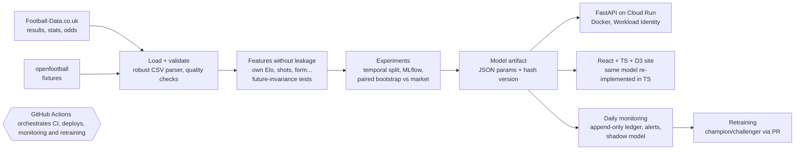

# Marcador Probable · five-league football match predictor

**An end-to-end, honestly evaluated football forecasting system:** it predicts the probability of every exact score of a
match in five leagues (Premier League, LaLiga, Serie A, Bundesliga and Ligue 1; and from it home / draw / away),
serves it through an API and a live website with a league selector, logs every prediction before kick-off in a
tamper-evident ledger, and tests every improvement with pre-registered experiments.

**[Live site](https://ignaciogil23.github.io/futbol-predict/)** (Spanish UI) · **[Model card](docs/model_card.md)** ·
[Versión en español](README.es.md)


## Results in 30 seconds

| Question | Answer |
|---|---|
| **Does it beat the betting market?** | **No, but it got much closer.** On the test seasons (2023-24 to 2025-26, 1,140 matches) log loss is **0.974** vs **0.966** for Bet365 pre-closing odds and **0.944** for Pinnacle closing; the gap to Bet365 is +0.008 (95% CI 0.001 to 0.014), down from +0.022 before the odds-based rating. It never uses the odds of the match it predicts. |
| **Is it competitive with published work?** | **Yes.** On the exact 3,300 matches of Ley, Van de Wiele & Van Eetvelde (2019, *Statistical Modelling*), RPS **0.1942** vs **0.1953** for the best of their 10 models (difference within our CI; protocol differences documented). |
| **What actually improves it?** | **Information the market already priced in.** An Elo rating updated with the market's pre-match expectation of *past* matches (Wunderlich & Memmert 2018) beat the results-based Elo by −0.0084 log loss on 19,763 matches across five leagues (CI [−0.0100, −0.0067], 51 of 55 league-seasons) and went to production on 2026-10-01 under a documented amendment; the old model is logged in parallel for a live comparison in July 2027. Shots also help (−0.004 to −0.005, replicated in four leagues) and are logged in parallel. |
| **What does not?** | Form, table, rest, head-to-head, Dixon-Coles, a bivariate Poisson, XGBoost (even trained on 5 leagues) and a recent home-advantage fix: each was tested and documented. Two experiments built on third-party data (Fantasy Premier League, Transfermarkt) were withdrawn because of those sources' terms of use. |
| **What can a fan ask it?** | **How the season ends.** 10,000 simulations of the remaining fixtures (Elo updated inside each run) give title, top-4 and relegation odds. Backtested on 2015-26 against a simulator that ignores team strength: 45% lower Brier for the top 4 before matchday 1, and well calibrated. It still gave Leicester 0% in 2015-16. |
| **Where is the gap to the market?** | Not in the averages but in match-level information: half of the gap comes from the 14% of matches where model and market disagree by 10+ points, and matchdays 1-5 double it (transfers the ratings have not absorbed yet). |

## Architecture



## How the model works

1. **Own Elo rating** updated match by match over the Premier League and Championship, with a goal-difference factor
   (Hvattum & Arntzen 2010), tuned only on training seasons. The same model runs in all five leagues.
2. **Two Poisson regressions** (home goals, away goals) on the Elo difference give the expected goals of each side;
   their product gives the probability of every score, and summing cells gives home / draw / away.
3. **Selection by evidence, not by complexity:** frequencies, an Elo logit, Dixon-Coles, the Poisson GLM and XGBoost were
   statistically indistinguishable in validation, so the simplest one won.

## Engineering decisions worth a look

* **Leakage is tested, not assumed.** Every feature for day *D* uses only matches before *D*. Tests blank all results
  from *D* on and require features for *D* to stay identical. They caught a real leak (a promoted team's starting Elo
  depended on later results).
* **Evaluation that cannot be gamed.** Temporal split with a test set used once; log loss as the primary metric; the
  market (Shin de-margining) as the benchmark; paired bootstrap confidence intervals; a fixed promotion rule
  (≥ 0.005 log loss and CI below 0).
* **Pre-registration.** Each new candidate has a protocol committed to git *before* its code and results
  (`docs/preregistro_*.md`), so the history proves the order. The other four leagues were the test bed for the model
  (so the Premier League data are not reused over and over) and are now also part of the product.
* **Tamper-evident monitoring.** Predictions are appended to a ledger on a separate branch before kick-off and never
  rewritten; alert thresholds come from a 10-season backtest; retraining arrives as a pull request with sanity checks.
* **Portable, auditable artifact.** The model is JSON parameters (no pickle) with a hash version; the website runs the
  same model in TypeScript, verified against Python test vectors.
* **Security.** Cloud Run deploys via Workload Identity Federation (no long-lived keys); the runtime service account
  has no permissions; the API image excludes scipy and pyarrow.


## Experiments log

| Candidate | Where tested | Log loss vs baseline | Outcome |
|---|---|---|---|
| **Betting-odds rating (ELO-Odds, Wunderlich & Memmert 2018)** | **5 leagues 2015-26 (19,763 matches)** | **−0.0084, CI [−0.0100, −0.0067]; halves the gap to Bet365** | **In production since 2026-10-01; old model logged in parallel** |
| Shots + shots on target | Premier League 2015-26; 4 other leagues | −0.004 / −0.005; replicated: −0.0049 | In parallel logging until July 2027 |
| Bivariate Poisson (Karlis & Ntzoufras 2003) | Premier League 2015-23 | exact-score log loss **worse** | Discarded (the draw excess did not persist after 2015) |
| Recent home advantage | 4 leagues | −0.0001 | Fixes the home bias, no log-loss gain |
| Pooled 5-league GLM / XGBoost | 4 leagues | +0.0001 / +0.0019 vs the shots model | Nothing beyond shots; XGBoost worse |
| Fantasy xG and line-ups; squad market value | — | — | Withdrawn: the sources' terms of use do not allow this use ([model card](docs/model_card.md)) |

Full tables, confidence intervals and reasoning: [model card](docs/model_card.md).

## Five leagues

The live product covers the Premier League (England), LaLiga (Spain), Serie A (Italy), the Bundesliga (Germany) and
Ligue 1 (France). The website has a league selector and every section (matches and previews, table and season
projection, statistics, team pages, out-of-sample review, monitoring) works per league; the API accepts `league`
(`ENG`, `ESP`, `ITA`, `GER`, `FRA`; default `ENG`).

* **Same model everywhere:** odds-based Elo (ELO-Odds) → two Poisson regressions (home and away goals) → probability
  of every exact score. Each league's regressions are trained on its own matches (Premier from 2004-05, Spain and
  France from 2005-06, Italy and Germany from 2006-07). Data: Football-Data.co.uk first and second divisions
  (SP1/SP2, I1/I2, D1/D2, F1/F2); schedules from openfootball (espana, italy, deutschland, europe/france).
* **League-specific rating parameters were tested and rejected.** Following a pre-registration
  ([`docs/preregistro_ligas.md`](docs/preregistro_ligas.md), report `reports/leagues/parametros_2026-10-27.json`),
  each league's two ratings were re-tuned on its 2004-05..2014-15 first division and compared out of sample
  (2015-16..2025-26) with England's parameters. Rule: adopt only if the mean log-loss difference is ≤ −0.002 and the
  99.375% CI (Bonferroni, 8 comparisons) is entirely below 0. None of the 8 comparisons met it (league minus England
  between −0.0002 and +0.0011), so every league uses the England-tuned parameters.

| League | Model log loss | Bet365 pre-closing |
|---|---|---|
| LaLiga | 0.9640 | 0.9529 |
| Serie A | 0.9771 | 0.9668 |
| Bundesliga | 0.9769 | 0.9614 |
| Ligue 1 | 0.9891 | 0.9819 |

Test seasons 2023-24 to 2025-26 (Premier League figures are in the table above).

* **Season simulation per league** (results-Elo model), validated with the Premier protocol (cutoffs proportional to the
  season: before matchday 1 and after 26%, 53% and 79% of matches; relegation spots per league; France 2019-20 skipped;
  reports in `reports/season/<LEAGUE>_evaluacion_2026-10-27.json`). Skill against the equal-teams baseline before
  matchday 1, top 4: Spain 71%, Italy 50%, Germany 49%, France 35%; champion: Spain 27%, Italy 39%, Germany 72%,
  France 50% (95% intervals in the reports). Head-to-head tiebreaks (LaLiga, Serie A) are not modelled; the
  Bundesliga and Ligue 1 16th place plays a promotion playoff and is not counted as relegated.
* **Live monitoring:** the Premier League ledger is unchanged; the monitoring workflow also logs pre-match predictions for the
  other leagues (`ledger/<LEAGUE>_predictions.csv` on the monitoring branch). Their live evaluation is not implemented
  yet: only the Premier League ledger is evaluated.
* Crests (all five leagues) and stadium photos for the other leagues come from Wikimedia Commons (free licences only, credited on each
  team page): stadium photos for 71 of the 76 current clubs of the other leagues and crests for 32 of them; the rest show 3-letter initials
  (most Spanish and French crests are copyrighted and not on Commons). Premier League clubs show initials: none of
  their current crests is on Commons with a free licence, and premierleague.com's terms do not allow reusing them.

## Tech stack

Python 3.11 · pandas · scikit-learn · XGBoost · MLflow · FastAPI · Docker · Google Cloud Run · GitHub Actions ·
React · TypeScript · Vite · D3 · pytest · Vitest · ruff · oxlint

## Reproduce

```bash
python -m venv venv && source venv/bin/activate        # Windows: venv\Scripts\activate
pip install -r requirements-dev.txt
python -m src.data.download && python -m src.data.load  # Football-Data (E0 + E1)
python -m src.data.leagues                              # other four leagues (first and second divisions)
python -m src.features.build
python -m src.serving.league_state                      # per-league rating state
python -m src.models.experiments --stage validation     # model selection (MLflow: mlflow.db)
python -m src.serving.production                        # models/production/model.json
python -m src.serving.league_models --train             # per-league Poisson models
python -m src.models.league_params                      # per-league rating-parameter check
python -m src.models.season_eval --league ESP           # season-simulation evaluation (per league)
python -m src.export.site --out web/public/data         # JSON for the website
pytest && ruff check .                                  # tests and lint (same as CI)
uvicorn src.api.main:app --reload                       # API
cd web && npm install && npm run dev                    # website
```

Other experiments (other leagues, shots) have their own entry points; each script documents its usage
in its docstring and each pre-registration names the command.

## Data and attribution

| Data | Source |
|---|---|
| Results, match statistics and odds (England, Spain, Italy, Germany, France) | [Football-Data.co.uk](https://www.football-data.co.uk/) |
| Fixtures | openfootball ([england](https://github.com/openfootball/england), [espana](https://github.com/openfootball/espana), [italy](https://github.com/openfootball/italy), [deutschland](https://github.com/openfootball/deutschland), [europe/france](https://github.com/openfootball/europe)) (public domain) |
| ClubElo ratings (comparison only) | [Club-Football-Match-Data](https://github.com/xgabora/Club-Football-Match-Data) |
| Club crests (website, all leagues) | Each club's Wikidata logo on [Wikimedia Commons](https://commons.wikimedia.org/), free licences only (public domain, CC0, CC BY/BY-SA with credit); trademarks of each club, shown only as a visual reference (`src/export/league_media.py`) |
| Stadium photos (website) | Lead image of each stadium's Wikipedia article, on [Wikimedia Commons](https://commons.wikimedia.org/) under CC BY / CC BY-SA; author and licence credited next to each photo (`src/export/stadiums.py`, `src/export/league_media.py`) |
| Club colours (data for site design) | Colours of each club's squad navbox on English Wikipedia (`bgcolor`/`textcolor`/`bordercolor`), or its home kit if there is no navbox; editors' identity colours, not official brand guidelines (`src/export/team_colors.py`, `configs/team_colors.json`) |

Raw data are downloaded at build time and not versioned; only aggregated reports are published.
Educational project. **Not betting advice.**

## License

The code is released under the [MIT License](LICENSE). Data, crests and photos belong to their respective sources
and keep their own terms (see the table above).
